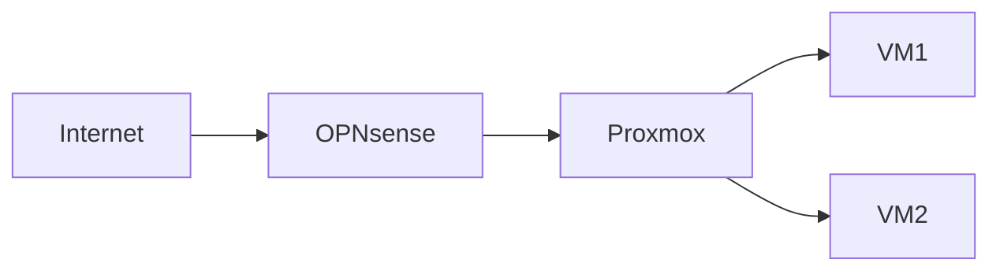

This is a sample post. Delete it or turn it into a draft by adding `draft: true` to the header.

## Code

Fenced code blocks are highlighted and get a copy button:

```bash
qm create 100 --name test-vm --memory 2048 --net0 virtio,bridge=vmbr0
```

## Diagrams

Mermaid diagrams render in the page:



## Adding a post

Add a `.md` file to `src/content/blog/` with `title`, `date` and optionally `tags`, `description` and `cover` (a path under `public/`). Without a cover, a pattern is generated from the post's name.
